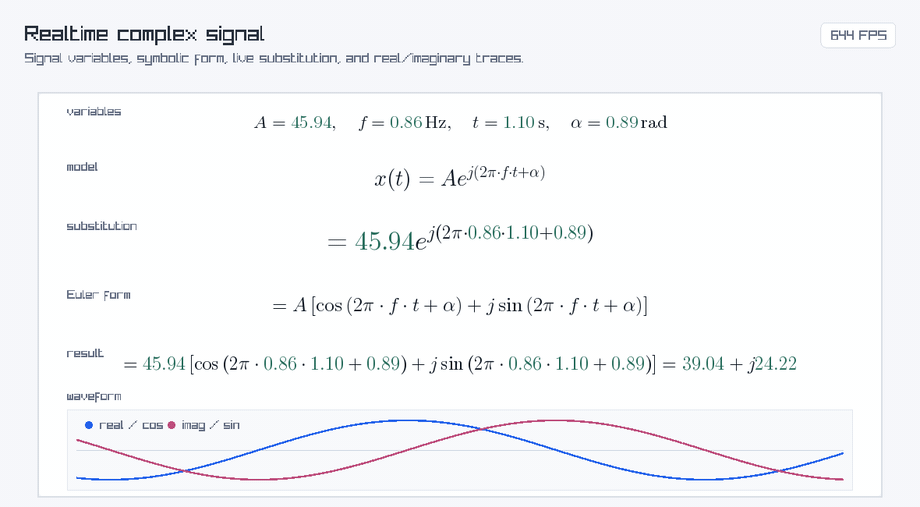

# TeXRender

[](https://github.com/nazimaraz/TeXRender/actions/workflows/ci.yml)
[](LICENSE)
[](CMakeLists.txt)

Render LaTeX math from C++ into raylib/SDL2 windows, offscreen RGBA buffers, or
SVG files.

TeXRender uses [MicroTeX](https://github.com/NanoMichael/MicroTeX)'s
`openmath` branch for parsing and formula layout, then draws the result through
a small backend-neutral rendering layer. The same `LatexDocument` API can render
into:

- a raylib window
- an SDL2 renderer
- a dependency-light in-memory `HeadlessSurface`
- a self-contained `SvgSurface`
- a custom `IDrawSurface`



## Quick Start

```sh
git submodule update --init --recursive
cmake -S . -B build -DTEXRENDER_BACKEND=headless
cmake --build build -j
ctest --test-dir build --output-on-failure
./build/texrender_offscreen 'e^{i\pi}+1=0' formula.png
```

Build the raylib demos:

```sh
cmake -S . -B build-raylib -DTEXRENDER_BACKEND=raylib
cmake --build build-raylib -j
./build-raylib/texrender_minimal
./build-raylib/texrender_realtime_values
./build-raylib/live_edit
```

Build the WebAssembly demo with Emscripten:

```sh
emcmake cmake -S . -B build-wasm -DCMAKE_BUILD_TYPE=Release
cmake --build build-wasm --target texrender_wasm -j
python3 -m http.server 8000 --directory build-wasm/wasm
```

Then open `http://localhost:8000`.

Build the raylib WebAssembly demo:

```sh
emcmake cmake -S . -B build-wasm-raylib -DCMAKE_BUILD_TYPE=Release -DTEXRENDER_BACKEND=raylib
cmake --build build-wasm-raylib --target texrender_wasm_raylib -j
python3 -m http.server 8001 --directory build-wasm-raylib/wasm-raylib
```

Then open `http://localhost:8001`.

## Requirements

- CMake 3.21+
- C++17 compiler
- Git submodules initialized with `git submodule update --init --recursive`

That is enough for the normal source build. TeXRender first looks for installed
packages, then falls back to the pinned submodules when
`TEXRENDER_USE_SUBMODULE_DEPENDENCIES=ON` (the default).

Installed packages are optional. They can make configure/build faster or let you
use system versions, but they are not required for the normal submodule-based
build. The raylib and SDL2 dependencies are needed only when their backends are
selected, and they can also come from initialized submodules.

## Use From CMake

Add TeXRender to your project as a submodule, then include it with
`add_subdirectory`:

```sh
git submodule add https://github.com/nazimaraz/TeXRender.git third_party/texrender
git submodule update --init --recursive
```

```cmake
add_subdirectory(third_party/texrender)

add_executable(my_app main.cpp)
target_link_libraries(my_app PRIVATE texrender::texrender)
texrender_copy_resources(my_app)
```

`texrender_copy_resources(my_app)` copies the MicroTeX resources next to
`my_app` and defines `TEXRENDER_RES_DIR` for that target.

## CMake Options

```text
TEXRENDER_BACKEND=headless|svg|raylib|sdl2
TEXRENDER_BUILD_EXAMPLES=ON|OFF
TEXRENDER_BUILD_TESTS=ON|OFF
TEXRENDER_BUILD_WASM_EXAMPLE=ON|OFF
TEXRENDER_USE_SUBMODULE_DEPENDENCIES=ON|OFF
TEXRENDER_MICROTEX_LOGS=ON|OFF
```

The default backend is `headless`. `HeadlessSurface` and `SvgSurface` are always
available to user code, even when the default backend is `raylib` or `sdl2`.
`TEXRENDER_BUILD_WASM_EXAMPLE` is enabled automatically only when configuring
with Emscripten.

## Basic Usage

```cpp
#include <raylib.h>
#include <texrender/latex_document.hpp>

int main()
{
    InitWindow(640, 360, "TeXRender");
    SetTargetFPS(60);
    const auto document = TeXRender::LatexDocument{TEXRENDER_RES_DIR};
    const auto formula = document.render(R"(e^{i\pi} + 1 = 0)", 60.f, 0xff000000);
    while (!WindowShouldClose())
    {
        BeginDrawing();
        ClearBackground(RAYWHITE);
        formula.draw((GetScreenWidth() - formula.width()) / 2, (GetScreenHeight() - formula.height()) / 2);
        EndDrawing();
    }

    CloseWindow();
    return 0;
}
```

`RenderHandle` is move-only and exposes:

- `width()`
- `height()`
- `depth()`
- `baseline()`
- `set_foreground(argb)`
- `draw(x, y)`

For caller-supplied input, prefer the non-throwing API:

```cpp
TeXRender::RenderOptions options;
options.text_size = 42.f;
options.argb = 0xff202020;
options.wrap_width = 800;

auto result = document.try_render_detailed(user_input, options);
if (result)
    result->draw(20, 20);
else
    show_error(result.error().message);
```

`try_render()` and `try_render_detailed()` apply guardrails for untrusted input.
They are not a security sandbox; run hostile input in a separate process with
OS-level limits.

## Resource Directory

MicroTeX needs its `res/` directory at runtime. The helper
`texrender_copy_resources(target)` copies that directory next to your executable
and defines `TEXRENDER_RES_DIR` for that target:

```cmake
target_link_libraries(my_app PRIVATE texrender::texrender)
texrender_copy_resources(my_app)
```

```cpp
TeXRender::LatexDocument document(TEXRENDER_RES_DIR);
```

If you package resources yourself, pass that path to `LatexDocument`.

## Offscreen Rendering

Use `HeadlessSurface` to render without opening a window:

```cpp
#include <memory>
#include <texrender/headless_surface.hpp>
#include <texrender/latex_document.hpp>

auto owned = std::make_unique<TeXRender::HeadlessSurface>();
auto& canvas = *owned;
TeXRender::LatexDocument document(TEXRENDER_RES_DIR, std::move(owned));

auto formula = document.render(R"(\int_0^1 x^2\,dx)", 48.f, 0xff000000);
canvas.resize(formula.width() + 20, formula.height() + 20);
canvas.clear(0xffffffff);
formula.draw(10, 10);
canvas.write_png("formula.png");
```

Use `SvgSurface` the same way when you want SVG output:

```cpp
#include <memory>
#include <texrender/svg_surface.hpp>
#include <texrender/latex_document.hpp>

auto owned = std::make_unique<TeXRender::SvgSurface>();
auto& svg = *owned;
TeXRender::LatexDocument document(TEXRENDER_RES_DIR, std::move(owned));

auto formula = document.render(R"(\sqrt{x+1})", 48.f, 0xff000000);
svg.resize(formula.width() + 20, formula.height() + 20);
svg.clear(0xffffffff);
formula.draw(10, 10);
svg.write_svg("formula.svg");
```

## Examples

The main examples are:

- `examples/minimal.cpp`: smallest raylib window example
- `examples/realtime_values.cpp`: animated raylib formulas
- `examples/live_edit.cpp`: raylib controls-style live editor with caret editing
- `examples/raylib_controls.cpp`: native raylib version of the WebAssembly controls demo
- `examples/offscreen.cpp`: render one formula to PNG or PPM
- `examples/headless_batch.cpp`: render several formulas offscreen
- `examples/svg_export.cpp`: write SVG output
- `examples/formula_label_widget.cpp`: baseline/layout helper example
- `examples/custom_surface.cpp`: minimal custom backend
- `examples/sdl2_minimal.cpp`: SDL2 renderer example
- `examples/wasm/`: SVG and raylib WebAssembly demos
- `examples/untrusted_worker.cpp`: process-boundary pattern for untrusted input

## How It Works

```text
LaTeX string
    |
    v
LatexDocument
    |
    v
microtex::MicroTeX::parse(...)  ->  microtex::Render
    |
    v
Graphics2DAdapter : microtex::Graphics2D
    |
    v
GlyphCache + FreeType
    |
    v
IDrawSurface
    |
    +--> RaylibSurface
    +--> Sdl2Surface
    +--> HeadlessSurface
    +--> SvgSurface
    +--> your custom surface
```

MicroTeX OpenMath draws by font glyph index. TeXRender keeps that detail inside
`Graphics2DAdapter` and `GlyphCache`: formulas are parsed by MicroTeX, glyphs
are rasterized with FreeType, and backend surfaces receive simple paint
operations in screen pixels.

OpenMath path rendering is disabled in this integration for now
(`GLYPH_RENDER_TYPE=2`); glyphs are rendered through platform fonts. The fallback
text path used by `\text{...}` maps Unicode codepoints to FreeType glyph indexes
before drawing.

## Threading and Lifetime

- Prefer rendering on one thread.
- Shared MicroTeX and glyph-cache paths are serialized internally.
- GPU backends still follow their toolkit rules, so raylib and SDL2 drawing
  should happen on the render thread.
- Use one MicroTeX resource root per process.
- Destroy documents and handles before closing the window, so backend GPU
  resources can be released while the graphics context still exists.

Set `TEXRENDER_DEBUG=1` for TeXRender diagnostics. Set
`TEXRENDER_MICROTEX_LOGS=ON` at CMake configure time only when you want
MicroTeX's own runtime logs.

## Tests

```sh
cmake -S . -B build -DTEXRENDER_BACKEND=headless -DTEXRENDER_BUILD_TESTS=ON
cmake --build build -j
ctest --test-dir build --output-on-failure
```

The current test target is `texrender_smoke_test`. It renders a small set of
math, `\mathrm{...}`, and `\text{...}` formulas into `HeadlessSurface` and fails
if parsing, dimensions, or pixel coverage are empty.

## Adding a Backend

Implement `IDrawSurface` from `include/texrender/draw_surface.hpp`, then inject
it into a document:

```cpp
TeXRender::LatexDocument document(TEXRENDER_RES_DIR, std::make_unique<MySurface>());
```

To add an in-tree default backend selected by `TEXRENDER_BACKEND`, add its
surface implementation and a small `make_surface` factory under
`source/backend/<name>/`, then add a branch in `CMakeLists.txt`.

## License

TeXRender is released under the [MIT License](LICENSE). It builds on MicroTeX,
raylib, SDL2, FreeType, TinyXML2, and bundled TeX/OpenType fonts, each with its
own license. Check third-party license files before redistributing binaries.
