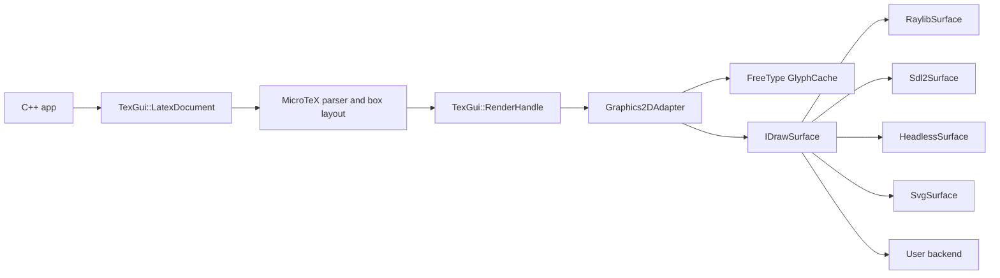
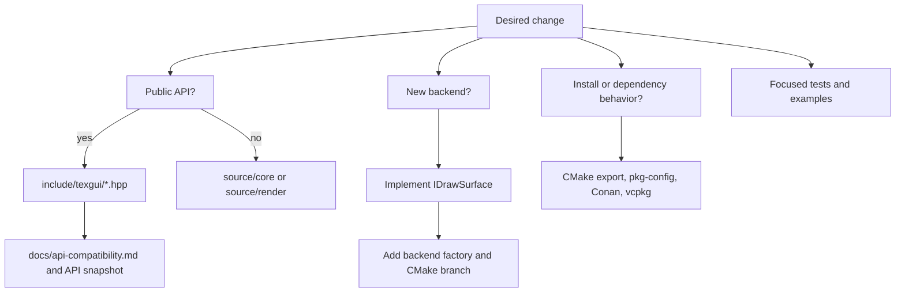

# Architecture

latex-renderer keeps the public API small and pushes toolkit-specific work to a
single drawing seam.



For contributors, the most common change paths look like this:



## Public Boundary

Applications include headers from `include/texgui/` and link `texgui::texgui`.
The primary objects are:

- `LatexDocument`: owns the runtime state and the drawing surface.
- `RenderHandle`: owns one parsed/layouted formula and can be moved, measured,
  recoloured and drawn.
- `IDrawSurface`: the backend interface for paint primitives and glyph bitmaps.
- `RaylibSurface` / `Sdl2Surface`: GUI surfaces that draw into caller-owned
  render loops.
- `HeadlessSurface`: a software RGBA canvas used by tests, CI and offscreen
  rendering.
- `SvgSurface`: a serialized SVG target with embedded glyph PNGs.

MicroTeX types do not appear in public headers. That keeps the integration
replaceable and lets the CMake package expose a stable target without asking
consumers to include MicroTeX internals.

## Rendering Pipeline

`LatexDocument::render()` asks MicroTeX to parse a UTF-8 LaTeX string and produce
a `tex::TeXRender`. When `RenderHandle::draw()` is called, MicroTeX paints into
`Graphics2DAdapter`, which translates MicroTeX's `tex::Graphics2D` calls into the
backend-neutral `IDrawSurface` operations.

Text rendering is character based in MicroTeX. The adapter therefore maps each
TeX font and Unicode codepoint to a FreeType rasterized glyph. `GlyphCache`
caches those CPU bitmaps with a configurable LRU limit; GUI surfaces such as
`RaylibSurface` and `Sdl2Surface` separately cache GPU textures with the same
glyph key.

## Backend Model

The backend does not own the application window or event loop. For raylib, the
user still calls `InitWindow`, `BeginDrawing`, `EndDrawing` and `CloseWindow`.
For SDL2, the user owns the `SDL_Window`, `SDL_Renderer`, and event loop.
`RaylibSurface` and `Sdl2Surface` only issue draw calls into the current frame.

Custom backends implement `IDrawSurface` and can be injected directly:

```cpp
TexGui::LatexDocument document(res_root, std::make_unique<MySurface>());
```

No core changes are required for out-of-tree backends. In-tree default backends
add a factory file selected by `TEXGUI_BACKEND`. See
[`docs/backend-authoring.md`](backend-authoring.md) for the draw contract,
glyph lifetime, color format and packaging checklist.

## Global State

MicroTeX initializes its resource tree once per process, so texgui documents
should use one resource root consistently. Shared MicroTeX/glyph-cache render
paths are serialized inside texgui. GUI backends still follow their toolkit
threading rules, so raylib/SDL2 drawing belongs on the rendering thread.

`try_render()` is the API for caller-supplied input. It catches parser failures
and applies default guardrails for input size and extreme layout requests before
MicroTeX is invoked.
