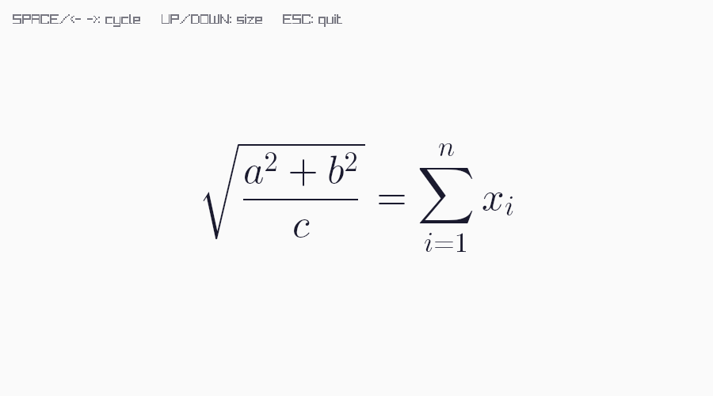
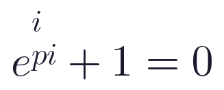

# Gallery

## Live Editor

The live editor uses the raylib backend and runs as either a native executable or
WebAssembly.

## Headless Output

The headless backend renders into an RGBA buffer and can write PNG/PPM snapshots for
tests, services, and command-line tooling. The PNG above is generated from
`texgui_headless_batch`.

## SVG Export

`texgui_svg_export` writes a self-contained SVG. Shape primitives stay as SVG
elements; glyphs are embedded as small PNG data URIs so the file has no runtime
font dependency.
