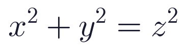
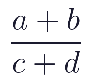
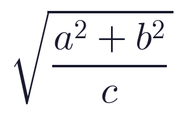
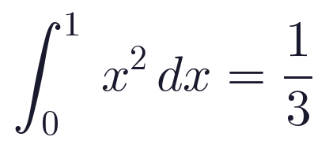
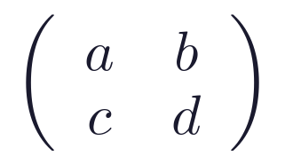
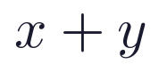

# Gallery

## Live Editor


The live editor uses the raylib backend and runs as either a native executable or
WebAssembly. After building `texrender_live`, refresh the README demo GIF from real
live-editor screenshots with:

```sh
TEXRENDER_BUILD_DIR=build-raylib scripts/record-live-editor-demo.sh
```

## Headless Output


The headless backend renders into an RGBA buffer and can write PNG/PPM snapshots for
tests, services, and command-line tooling. The PNG above is generated from
`texrender_headless_batch`.

## SVG Export

`texrender_svg_export` writes a self-contained SVG. Shape primitives stay as SVG
elements; glyphs are embedded as small PNG data URIs so the file has no runtime
font dependency.

## Generated Artifacts

The committed gallery sample set is listed in
[`gallery-formulas.txt`](gallery-formulas.txt), with generated PNG/SVG output in
[`docs/gallery/`](gallery/).

| Formula | PNG | SVG |
| --- | --- | --- |
| Pythagorean |  | [SVG](gallery/pythagorean.svg) |
| Fraction |  | [SVG](gallery/fraction.svg) |
| Radical |  | [SVG](gallery/radical.svg) |
| Integral |  | [SVG](gallery/integral.svg) |
| Matrix |  | [SVG](gallery/matrix.svg) |
| Colored |  | [SVG](gallery/colored.svg) |

After building a backend that includes `texrender_offscreen` and
`texrender_svg_export`, refresh the committed PNG/SVG artifacts with:

```sh
TEXRENDER_BUILD_DIR=build-headless scripts/generate-gallery.sh docs/gallery-formulas.txt docs/gallery
scripts/generate-preview-gif.sh
```

CI also uploads generated gallery artifacts from the Linux headless job, and
`scripts/verify-release.sh` renders them during local release verification. The
headless `generate-preview-gif.sh` path is a display-free fallback; use
`record-live-editor-demo.sh` for the public README/release GIF when a raylib
build can open a window.
